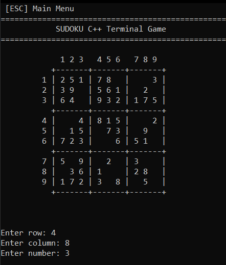
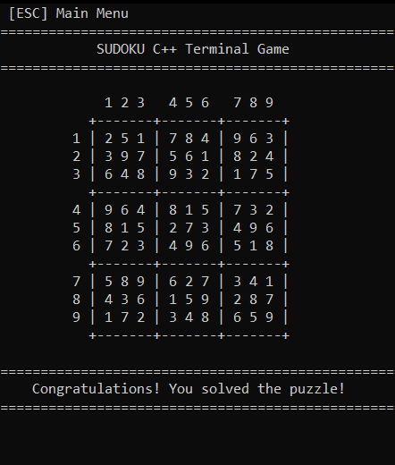

# Sudoku Terminal Game

## Project Overview
Sudoku Terminal Game is a Windows-based C++ application that generates randomized 9x9
Sudoku puzzles and allows users to solve them through keyboard input. The program 
uses recursive backtracking to generate completed boards and removes numbers while 
verifying that each puzzle maintains a unique solution. It also validates player 
input, rejects invalid moves, and detects when a puzzle has been successfully 
completed.

I grew up solving Sudoku puzzles, so when I wanted a project to strengthen my C++ 
programming skills, building a Sudoku game felt like a natural choice. As I developed
the application, I discovered that generating valid puzzles was more challenging than
I initially expected, particularly ensuring that each puzzle had a unique solution. 
Working through this strengthened my understanding of recursive backtracking and 
improved my problem-solving skills.

## Features
- **Randomized Puzzle Generation:** Recursive backtracking is used to fill a 9x9 
Sudoku board while following Sudoku rules. During this process, candidate numbers are
shuffled before being tested in each cell, producing randomized completed boards.

- **Unique-Solution Verification:** The program attempts to remove 30 numbers from a 
completed Sudoku board to create a playable puzzle. After each removal, recursive 
backtracking is used to count the number of possible solutions. If more than one 
solution is found, the removed number is restored to ensure the puzzle maintains a 
unique solution.

- **Move Validation:** The user is prompted to enter a row, column, and number 
between 1 and 9. The program validates these inputs by checking whether the selected 
cell is occupied and whether the entered number matches the generated solution. If an
invalid or incorrect move is detected, the program displays an error message and 
prompts the user to enter another move.

- **Console Gameplay and Navigation:** The application starts with a main menu where 
players can press `Enter` to begin a new puzzle. The game then displays a 9x9 Sudoku 
board with labeled rows and columns and nine visually separated 3x3 boxes. Players 
can press `Escape` during gameplay to return to the main menu or press `Escape` from 
the main menu to exit the application.

- **Terminal Screen Preservation:** The application uses an alternate terminal screen 
to display the game without clearing the user's existing terminal output. When the 
application exits normally, it restores the original terminal screen and console 
settings.

- **Puzzle Completion Detection:** The program checks whether the player's board 
matches the generated solution to determine when the puzzle is complete. Once the 
puzzle is completed, the program displays the finished board and a congratulatory 
message informing the player that they have successfully solved the puzzle.

## How to Play

**1. Starting the game**
- Press `Enter` from the main menu to generate and begin a new Sudoku puzzle.
	
**2. Selecting a cell**
- Enter a row number between 1 and 9, then press `Enter`.
- Enter a column number between 1 and 9, then press `Enter`.

**3. Entering a number**
- Enter a number between 1 and 9 for the selected cell, then press `Enter`.
- The program checks the move and displays an error message if it is invalid or 
incorrect.
	
**4. Correcting input**
- Use `Backspace` to correct an entry before submitting it.
- Continue entering moves until the puzzle is completed.
	
**5. Completing or exiting the game**
- Completing the puzzle displays a congratulations screen.
- Press `Escape` from the puzzle screen to return to the main menu.
- Press `Escape` from the main menu to exit the application.

## Technologies Used
- **C++:** Developed the application using object-oriented design, separating Sudoku 
logic, gameplay, and terminal management into dedicated classes.
- **C++ Standard Library:** Used `std::array` to store puzzle boards and 
`std::mt19937` with `std::shuffle` to randomize puzzle generation.
- **Windows Console API:** Used `GetConsoleMode()` and `SetConsoleMode()` to 
configure the terminal, along with `_getch()` for keyboard input.
- **Virtual Terminal (VT) Sequences:** Implemented alternate-screen rendering to 
preserve existing terminal output and restore it when the game exits normally.
- **Git:** Used for version control throughout development.

## How to Run

### Prerequisites
- Windows 10 or Windows 11
- C++11-compatible compiler (MSVC or MinGW-w64)
- Git (for cloning the repository)

### Setup
1. Clone the GitHub repository:
   ```cmd
   git clone https://github.com/carterbier/SudokuTerminalGame.git
   ```
2. Navigate to the project directory:
   ```cmd
   cd SudokuTerminalGame
   ```

### Compile and Run
1. Compile the C++ source files using either MSVC or MinGW-w64:
   
   **MSVC (Visual Studio Developer PowerShell)**
   ```powershell
   cl /EHsc Sudoku\main.cpp Sudoku\Game.cpp Sudoku\Sudoku.cpp Sudoku\Terminal.cpp /Fe:Sudoku.exe
   ```
   **MinGW-w64 (Command Prompt or PowerShell)**
   ```cmd
   g++ -std=c++11 Sudoku/main.cpp Sudoku/Game.cpp Sudoku/Sudoku.cpp Sudoku/Terminal.cpp -o Sudoku.exe
   ```

2. Run the application from the project directory:
   ```cmd
   .\Sudoku.exe
   ```

## Example Output

| Gameplay | Puzzle Completion |
|---|---|
|  |  |

## Current Limitations
- **Manual Cell Selection:** Players must enter the row, column, and number 
individually rather than navigating the board using arrow keys.
- **No Difficulty Selection:** The game attempts to remove 30 numbers from each 
puzzle rather than offering selectable difficulty levels.
- **No Save Functionality:** Players cannot save an unfinished puzzle and resume it 
after closing the application.

## Future Improvements
- **Improved Keyboard Navigation:** Allow players to navigate the Sudoku board using 
arrow keys and enter numbers directly into selected cells.
- **Visual Feedback:** Highlight selected cells and correctly entered numbers to make 
gameplay more intuitive.
- **Difficulty Settings:** Introduce selectable difficulty levels with varying puzzle 
complexity.
- **Additional Gameplay Features:** Implement a game timer, mistake tracking, and the 
ability to save and resume unfinished puzzles.